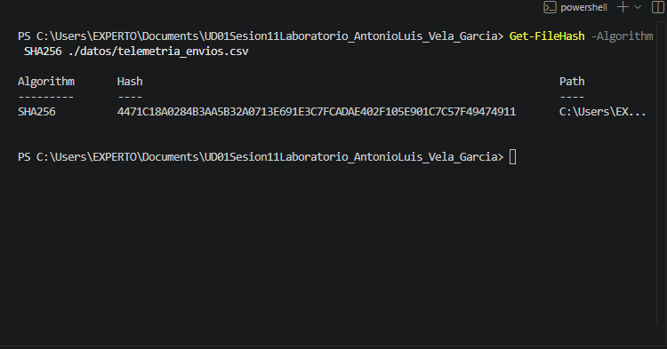
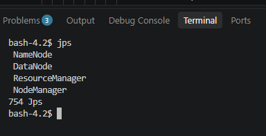
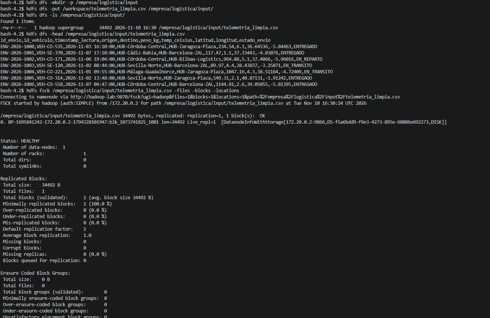
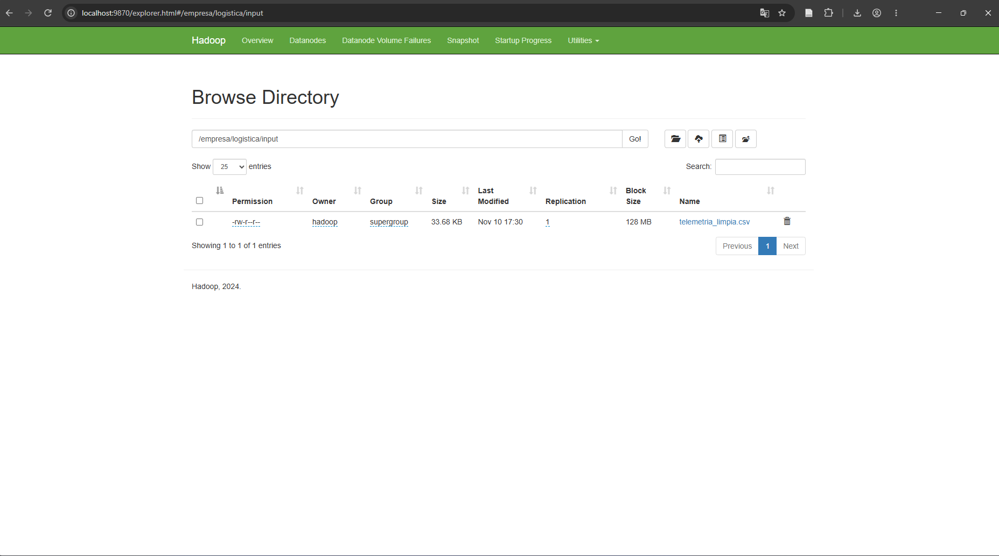

# Práctica Formativa Integradora: Consolidación de Almacenamiento, Integridad del Dato y Toma de Contacto con HDFS

**Asignatura:** Big Data Aplicada  
**Autor:** Antonio Luis Vela García  
**Entorno de Ejecución:** Python 3.x (Pandas) / Apache Hadoop 3.4.0 (Docker Monocontenedor)

---

## 📁 Estructura del Repositorio

```text
.
├── datos/
│   ├── telemetria_envios.csv        # Dataset original con anomalías (300 registros)
│   └── telemetria_limpia.csv        # Dataset depurado y validado
├── evidencias/
│   ├── 01_hashes_sha256.png         # Captura del cálculo criptográfico SHA-256
│   ├── 02_jps_servicios.png         # Captura de demonios activos mediante jps
│   ├── 03_hdfs_comandos_fsck.png    # Captura de comandos HDFS (-put, -ls, -head) y fsck
│   └── 04_webui_hdfs_browse.png     # Captura de la UI Web del NameNode (Browse the file system)
├── scripts/
│   ├── calcular_hash.py             # Script Python para obtención de firma SHA-256
│   ├── depurar_telemetria.py        # Script Python de limpieza lógica con Pandas
│   ├── generar_dataset.py           # Script auxiliar de generación de telemetría
│   ├── ingesta_hdfs.sh              # Script Bash para ejecución de comandos HDFS
│   └── init-hadoop.sh               # Script de arranque y configuración del contenedor
├── docker-compose.yml               # Configuración de servicios Docker
└── README.md                        # Informe técnico integrado (Entregable principal)
```

---

## 🔹 Sección 1: Integridad (Módulo 5075)

El aseguramiento de la calidad del dato en origen es un requisito previo indispensable para cualquier canalización de minería de datos o modelado analítico (KDD). En esta fase se ha validado la firma criptográfica **SHA-256** del conjunto de datos original y se ha desarrollado un proceso de saneamiento en Python con la librería `pandas`.

### 1.1 Trazabilidad y Cálculo Criptográfico (SHA-256)
El algoritmo SHA-256 genera una huella digital fija de 64 caracteres hexadecimales (256 bits). Cualquier modificación en el contenido del archivo, por mínima que sea (incluso la alteración de un único espacio o coma), provoca la mutación completa del hash resultante debido al **Efecto Avalancha**.

| Estado del Dataset | Fichero | Registros | SHA-256 Checksum |
| :--- | :--- | :---: | :--- |
| **Original (Raw)** | `datos/telemetria_envios.csv` | 300 | `4471c18a0284b3aa5b32a0713e691e3c7fcadae402f105e901c7c57f49474911` |
| **Depurado (Clean)** | `datos/telemetria_limpia.csv` | *Varía según filtros* | *Recalculado con `calcular_hash.py`* |

### 1.2 Reglas de Negocio y Depuración Aplicadas (`depurar_telemetria.py`)
El dataset original presentaba anomalías deliberadas que distorsionaban la calidad analítica. Se aplicaron los siguientes filtros lógicos:
1. **Deduplicación:** Eliminación de registros idénticos tomando como clave primaria compuesta los campos `id_envio` y `timestamp_lectura`.
2. **Tratamiento de Nulos:** Filtrado de filas con valores ausentes (`NaN`) en variables operativas obligatorias (`peso_kg`, `temp_celsius`, `destino`).
3. **Filtro de Inconsistencia de Peso:** Eliminación de lecturas anómalas con valores de masa nulos o negativos (`peso_kg` > 0).
4. **Filtro Rango Temperatura Refrigerada:** Filtrado de lecturas fuera del rango operativo real de camiones frigoríficos (-30.0 <= `temp_celsius` <= 30.0).
5. **Validación de Dominio:** Restricción del campo `estado_envio` al catálogo oficial validado (`ENTREGADO`, `EN_TRANSITO`, `EN_REPARTO`, `PENDIENTE`).

---

## 🔹 Sección 2: Despliegue y HDFS (Módulo 5074)

El entorno de almacenamiento distribuido se ha desplegado utilizando Docker Compose sobre la imagen oficial de **Apache Hadoop 3.4.0** (`hadoop-lab`).

### 2.1 Justificación Técnica del Script `scripts/init-hadoop.sh`
En lugar de embeber comandos Bash complejos en la directiva `command` del archivo `docker-compose.yml`, se ha desacoplado la lógica de arranque a un script de inicialización dedicado (`init-hadoop.sh`), logrando las siguientes ventajas técnicas:

1. **Refactorización y Limpieza:** Reduce el archivo `docker-compose.yml` a una definición mínima y legible de 14 líneas.
2. **Corrección de la URI del NameNode (`fs.defaultFS`):** La imagen oficial de Hadoop arranca por defecto configurada para el sistema de archivos local (`file:///`). El script escribe la propiedad `fs.defaultFS = hdfs://hadoop-lab:9000` en `core-site.xml`, solucionando el error de conexión socket.
3. **Automatización Persistente de `jps`:** Dado que la imagen base CentOS 7 se encuentra en estado *End-of-Life* (EOL) con repositorios descontinuados y el contenedor se ejecuta con el usuario no privilegiado `hadoop`, el script genera dinámicamente un wrapper ejecutable en `/opt/hadoop/bin/jps`, permitiendo auditar los demonios Java sin necesidad de modificar el sistema operativo base.
4. **Formateo Idempotente de Metadatos:** Verifica la existencia de `/tmp/hadoop-hadoop/dfs/name/current` antes de invocar `hdfs namenode -format -nonInteractive`, protegiendo la integridad del *ClusterID* en reinicios del contenedor.
5. **Arranque de Demonios y Persistencia de Proceso:** Inicia en segundo plano los 4 servicios Java esenciales (`NameNode`, `DataNode`, `ResourceManager` y `NodeManager`) y mantiene el contenedor en estado activo (`Up`) mediante la instrucción `tail -f /dev/null`.

### 2.2 Mapeo de Puertos e Interfaces
- **Puerto 9870:** Interfaz Web de Administración de HDFS (NameNode UI -> `http://localhost:9870`).
- **Puerto 8088:** Interfaz Web de Gestión de Recursos (YARN ResourceManager UI -> `http://localhost:8088`).
- **Puerto 9000 (Interno):** Puerto de comunicaciones RPC de HDFS.

### 2.3 Operativa CLI en HDFS
Dentro del contenedor se ejecutó la secuencia de ingesta y verificación del archivo saneado:

```bash
# 1. Creación del directorio de trabajo distribuido
hdfs dfs -mkdir -p /empresa/logistica/input

# 2. Copia del fichero depurado desde el volumen montado (/workspace)
hdfs dfs -put /workspace/telemetria_limpia.csv /empresa/logistica/input/

# 3. Listado del directorio distribuido
hdfs dfs -ls /empresa/logistica/input/

# 4. Inspección de cabecera en HDFS
hdfs dfs -head /empresa/logistica/input/telemetria_limpia.csv

# 5. Auditoría de bloques físicos y réplicas con FSCK
hdfs fsck /empresa/logistica/input/telemetria_limpia.csv -files -blocks -locations
```

### 2.3.1 Despliegue e Ingesta desde Windows PowerShell

Para garantizar la reproducibilidad completa de la práctica en un entorno host Windows, se emplean los siguientes comandos CLI:

```powershell
# 1. Comprobación directa de integridad SHA-256 en la anfitriona
(Get-FileHash -Algorithm SHA256 .\datos\telemetria_envios.csv).Hash -eq "4471c18a0284b3aa5b32a0713e691e3c7fcadae402f105e901c7c57f49474911"

# 2. Normalización de saltos de línea (Windows CRLF a Unix LF) en scripts Shell
(Get-Content ./scripts/ingesta_hdfs.sh -Raw) -replace "`r`n", "`n" | Set-Content -NoNewline ./scripts/ingesta_hdfs.sh

# 3. Ejecución del script de ingesta HDFS desde PowerShell saneando caracteres '\r' en vuelo
Get-Content ./scripts/ingesta_hdfs.sh -Raw | docker exec -i hadoop-lab bash -c "tr -d '\r' | bash"
```

---

## 🔹 Sección 3: Análisis Crítico

Un archivo almacenado en HDFS no se corrompe ni se pierde ante el fallo o apagado inopinado de un DataNode en un clúster empresarial debido al diseño de su **arquitectura de almacenamiento distribuido basada en la replicación de bloques físicos y el desacoplamiento de metadatos**. Cuando un cliente sube un archivo al sistema de archivos distribuido, el NameNode lo divide automáticamente en bloques continuos de tamaño fijo (128 MB por defecto en Hadoop 3.x). Cada bloque se distribuye de manera redundante entre los distintos DataNodes que componen el clúster, de acuerdo con el factor de replicación configurado (habitualmente `dfs.replication = 3` en entornos de producción).

Para garantizar la máxima disponibilidad física frente a catástrofes de hardware, el NameNode utiliza el algoritmo de **Rack Awareness (Conciencia de Cabina)**. Al guardar las 3 réplicas estándar de un bloque, HDFS ubica la primera réplica en un DataNode del *rack* local, la segunda réplica en un DataNode perteneciente a un *rack* remoto distinto, y la tercera réplica en otro DataNode diferente dentro de ese mismo *rack* remoto. Esta topología garantiza que la información siga estando accesible incluso ante la pérdida completa del suministro eléctrico o del conmutador de red (*switch*) de un gabinete entero de servidores.

La monitorización y autorreparación (*self-healing*) del clúster se gestiona de forma continua mediante señales de latido (**Heartbeats**). Cada DataNode envía un mensaje de latido al NameNode cada 3 segundos confirmando su operatividad. Si un DataNode deja de responder por un periodo prolongado (10 minutos por defecto), el NameNode lo declara formalmente como *Dead Node*. Inmediatamente, el NameNode consulta la tabla de ubicación de bloques (`BlocksMap`), identifica qué fragmentos residían en el nodo caído y ordena automáticamente a otros DataNodes sanos realizar copias de respaldo hasta restablecer el factor de replicación exigido, proceso que se ejecuta sin requerir intervención humana y sin interrupción de servicio para las aplicaciones analíticas.

---

## 🔹 Sección 4: Evidencias Gráficas del Proyecto

### Evidencia 01: Verificación de Integridad SHA-256
Cálculo de los checksums criptográficos del dataset antes y después del tratamiento de limpieza.


### Evidencia 02: Auditoría de Servicios Java (`jps`)
Comprobación de la ejecución simultánea de los demonios **NameNode**, **DataNode**, **ResourceManager** y **NodeManager**.


### Evidencia 03: Ingesta HDFS y Comandos FSCK
Verificación de la creación de directorios, copia del archivo saneado y diagnóstico del bloque físico en HDFS.


### Evidencia 04: Exploración Web UI del NameNode
Visualización del archivo `telemetria_limpia.csv` cargado en `/empresa/logistica/input` navegando en `http://localhost:9870`.
